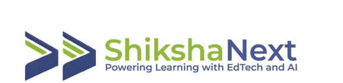
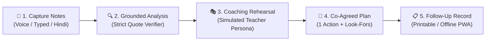
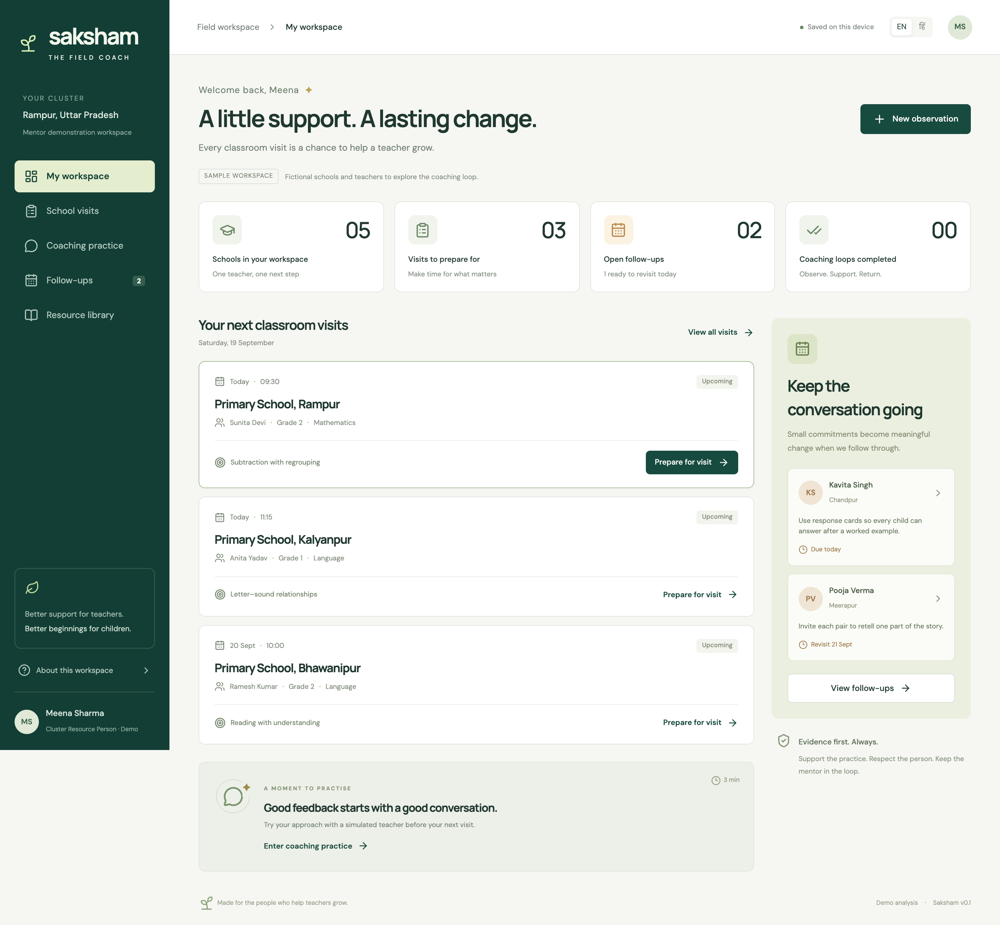
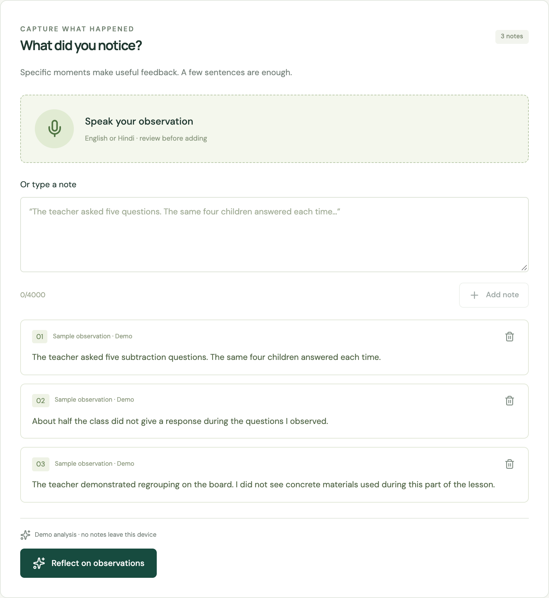
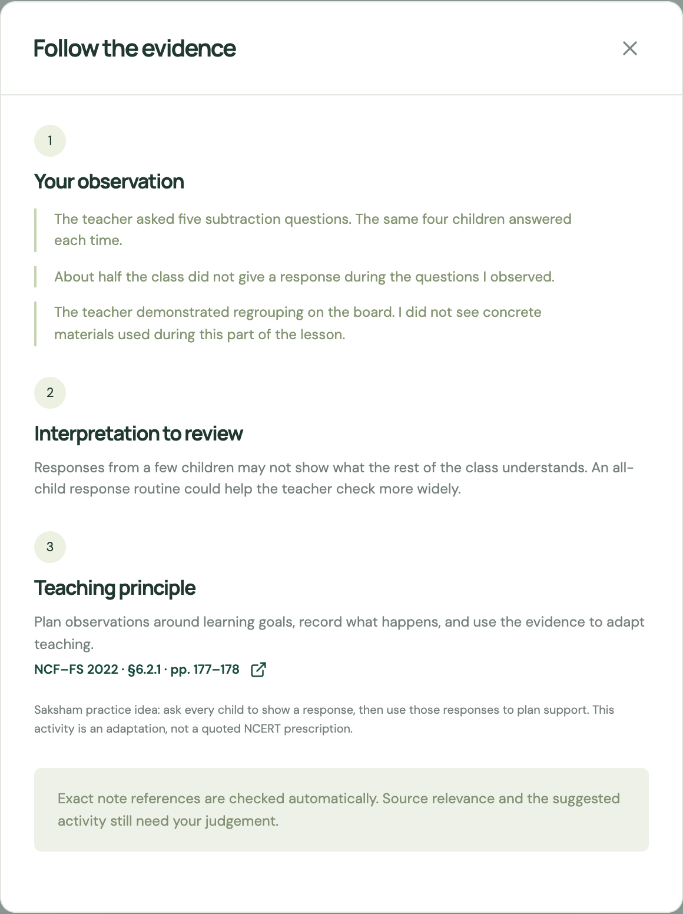
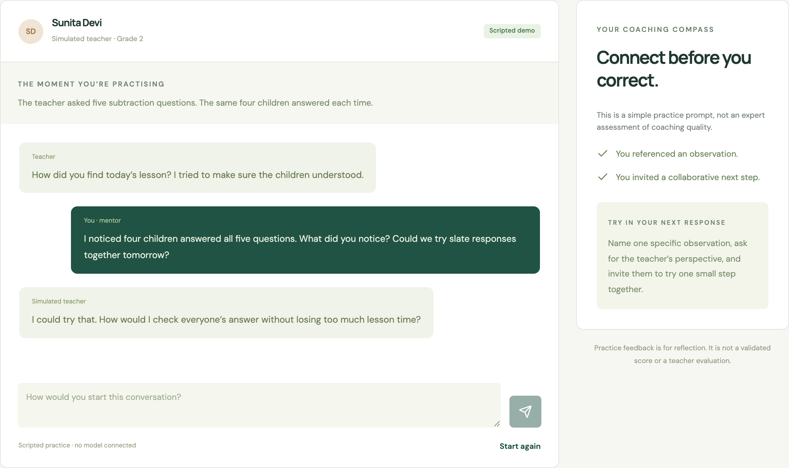
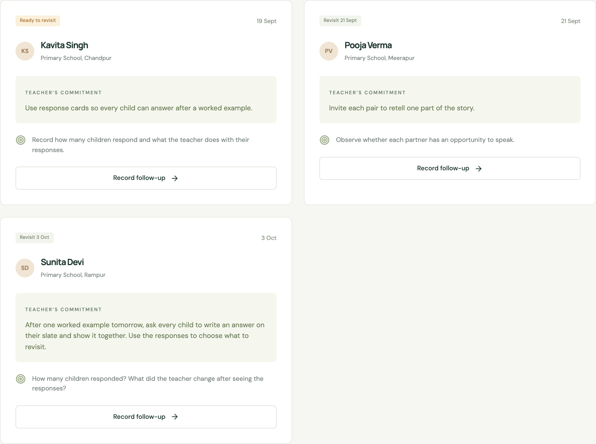
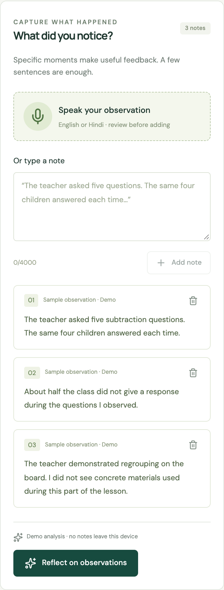
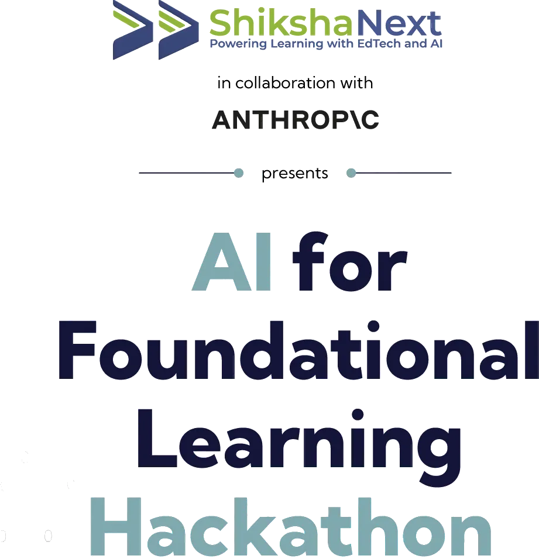

<p align="center">
  
</p>

<h1 align="center">Saksham AI (सक्षम AI)</h1>

<p align="center">
  <b>An Evidence-Grounded Field Workspace for Teacher Mentors & Cluster Resource Persons (CRPs)</b><br>
  <i>Empowering instructional mentors to transform raw classroom observations into focused, evidence-backed coaching dialogues for Foundational Literacy and Numeracy (FLN).</i>
</p>

<p align="center">
  <a href="#-table-of-contents"></a>
  <a href="https://opensource.org/licenses/MIT"></a>
  <a href="https://nextjs.org"></a>
  <a href="https://react.dev"></a>
  <a href="https://www.typescriptlang.org"></a>
  <a href="https://anthropic.com"></a>
</p>

---

## 📑 Table of Contents

- [🌟 Executive Summary](#-executive-summary)
- [🎯 The Problem: Mentoring Capacity in Foundational Learning](#-the-problem-mentoring-capacity-in-foundational-learning)
- [💡 The Solution: Saksham AI](#-the-solution-saksham-ai)
- [✨ Core Capabilities & Architecture](#-core-capabilities--architecture)
  - [1. Low-Friction Classroom Observation](#1-low-friction-classroom-observation)
  - [2. Deterministic & Grounded AI Analysis](#2-deterministic--grounded-ai-analysis)
  - [3. Interactive Coaching Rehearsal Sandbox](#3-interactive-coaching-rehearsal-sandbox)
  - [4. Single-Focus Action Commitments](#4-single-focus-action-commitments)
  - [5. Official Printable Field Coaching Records](#5-official-printable-field-coaching-records)
  - [6. Privacy by Design & Zero Child PII](#6-privacy-by-design--zero-child-pii)
- [📸 Visual Tour & Product Walkthrough](#-visual-tour--product-walkthrough)
- [🏗️ System Architecture & Reasoning Workflow](#️-system-architecture--reasoning-workflow)
- [🚀 Quickstart & Local Setup](#-quickstart--local-setup)
- [🧪 Validation & Quality Assurance](#-validation--quality-assurance)
- [📚 Pedagogical Grounding & References](#-pedagogical-grounding--references)
- [👥 Contributors](#-contributors)
- [🤝 Hackathon Organizers & Partners](#-hackathon-organizers--partners)

---

## 🌟 Executive Summary

In India's foundational school ecosystem, **Cluster Resource Persons (CRPs)** and **teacher mentors** serve on the front lines of improving learning outcomes across thousands of primary classrooms. However, a single mentor is often responsible for **30 to 40+ schools**. Mentors conduct classroom visits but are weighed down by compliance checklists, lack structured frameworks to synthesize observational data, and receive no safe environment to practice empathetic, non-judgmental coaching before conversing with teachers.

**Saksham AI (सक्षम AI)** bridges this mentoring gap. Developed as an Ideate proposal and functional prototype for **Challenge 5 (System Capacity)** in the **AI for Foundational Learning Hackathon**, Saksham AI is an evidence-grounded field companion designed around the mentor’s real school day. It converts live observational notes into concrete pedagogical insights anchored directly in **NCF-FS 2022**, simulates realistic coaching dialogues so mentors can rehearse constructive feedback, and establishes a single co-agreed commitment with verifiable classroom look-fors.

---

## 🎯 The Problem: Mentoring Capacity in Foundational Learning

According to research from the **NITI Aayog (2026)** and the **World Bank Coach Initiative**, mentoring quality—not mere visit frequency—is the determining factor in teacher instructional shifts.

```
┌───────────────────────────────┐        ┌───────────────────────────────┐
│     The Existing Reality      │        │     The Consequence           │
├───────────────────────────────┤        ├───────────────────────────────┤
│ • 1 Mentor : 30–40+ Schools   │  ───►  │ • High compliance inspection  │
│ • Unstructured mental notes   │        │ • Generic, judgmental feedback│
│ • Zero prep/rehearsal time    │        │ • Overwhelmed teachers        │
│ • Checklists without pedagogy │        │ • No measurable practice change│
└───────────────────────────────┘        └───────────────────────────────┘
```

1. **The Visit-to-Change Chasm**: Mentors record notes, but without synthesis tools, feedback defaults to subjective evaluation (*"Teacher should maintain discipline"* rather than specific instructional adjustments).
2. **High-Stakes Conversational Friction**: Pointing out classroom shortcomings directly often triggers defensiveness. Mentors lack a safe rehearsal space to practice collaborative phrasing.
3. **Over-Ambitious Action Plans**: Traditional visit forms mandate lists of 5–10 broad goals that are forgotten before the next visit. Effective coaching requires **one atomic, high-leverage practice** agreed upon collaboratively.
4. **Hallucination Risk in Generic AI**: General LLMs produce generic Western pedagogical advice or hallucinate guidelines that conflict with state curricula and national foundational standards.

---

## 💡 The Solution: Saksham AI

Saksham AI provides a structured, 5-phase closed-loop workflow that respects the mentor’s field reality:



- **Grounded in Ground Truth**: Recommendations are explicitly linked to direct quotes from observational notes and referenced against **NCERT NCF-FS 2022** guidelines.
- **Bilingual Field Readiness**: Seamlessly handles Hindi and English classroom notes, reflections, and pedagogical prompts.
- **Offline-First PWA Shell**: Fully functional in low-connectivity rural school environments with local device persistence and zero external tracking.

---

## ✨ Core Capabilities & Architecture

### 1. Low-Friction Classroom Observation
- Quick multi-modal entry: type rapid notes or dictate via web speech input during live instruction.
- Built-in curated foundational prompts and sample notes covering critical FLN scenarios (e.g., *Subtraction with regrouping*, *Letter-sound correspondences*, *Pair talk in storytelling*).
- Bilingual toggle (English / हिंदी) adapted for state field cadres.

### 2. Deterministic & Grounded AI Analysis
- Every AI-generated priority is required to cite verified text quotes from the mentor’s actual notes.
- The `validateGrounding` engine checks every evidence citation against raw note content; **if an AI assertion cannot be grounded, it is rejected**.
- Directly maps observations to relevant sections of the **National Curriculum Framework for Foundational Stage (NCF-FS 2022)** (e.g., Section 6.2.1 on evidence-driven reflection, Section 5.4 on tangible learning materials).

### 3. Interactive Coaching Rehearsal Sandbox
- Before having the sensitive face-to-face debrief, mentors can rehearse with an AI-simulated teacher persona.
- The persona reacts realistically to the mentor's phrasing:
  - If the mentor is accusatory or vague, the teacher reacts defensively (*"I asked questions, several students answered correctly, why change?"*).
  - If the mentor leads with grounded evidence and an invitation to collaborate, the teacher opens up to co-planning.
- Immediate formative feedback scores the mentor's phrasing for evidence citation, collaborative stance, and specificity.

### 4. Single-Focus Action Commitments
- Replaces unmanageable inspection checklists with **one actionable commitment**.
- Clearly articulates:
  - **Teacher's Action**: Exact micro-step (e.g., *"Ask every child to show an answer on their slate simultaneously"*).
  - **Mentor's Commitment**: Tangible support the mentor will provide (e.g., *"Bring reusable slate response cards"*).
  - **Verifiable Look-Fors**: Observable student and teacher behaviors for the follow-up visit.

### 5. Official Printable Field Coaching Records
- Generates a clean, formal printable coaching record ready for school logbooks and cluster documentation.
- Retains visit history, commitment statuses, and follow-up reviews directly in local storage.

### 6. Privacy by Design & Zero Child PII
- Designed specifically for government school contexts: **no child names, photos, or personally identifiable information (PII)** are collected or transmitted.
- Server-side token management ensures credentials never leak to the client.

---

## 📸 Visual Tour & Product Walkthrough

<div align="center">
  <h3>Field Workspace Dashboard</h3>
  
  <p><i>Overview of scheduled school visits, status trackers, and field visit logs.</i></p>
</div>

<br>

<div align="center">
  <table width="100%">
    <tr>
      <td width="50%" align="center">
        <h4>Live Observation Capture</h4>
        
        <p><i>Rapid timestamped note-taking with voice and sample prompt assistance.</i></p>
      </td>
      <td width="50%" align="center">
        <h4>Evidence-Grounded Insights</h4>
        
        <p><i>Direct quote-to-recommendation verification mapped to NCF-FS standards.</i></p>
      </td>
    </tr>
    <tr>
      <td width="50%" align="center">
        <h4>Coaching Rehearsal Dialogue</h4>
        
        <p><i>Mentor practices constructive conversational framing against realistic teacher personas.</i></p>
      </td>
      <td width="50%" align="center">
        <h4>Commitments & Follow-Up Tracking</h4>
        
        <p><i>Single high-leverage action agreed with measurable look-fors for next visit.</i></p>
      </td>
    </tr>
  </table>
</div>

<br>

<div align="center">
  <table width="100%">
    <tr>
      <td width="50%" align="center">
        <h4>Mobile Responsive Interface</h4>
        
        <p><i>Field-tested at 390px viewport width for low-end Android smartphones.</i></p>
      </td>
      <td width="50%" align="center">
        <h4>Field Mentor Persona</h4>
        
        <p><i>Built from real field research with Cluster Resource Persons.</i></p>
      </td>
    </tr>
  </table>
</div>

---

## 🏗️ System Architecture & Reasoning Workflow

```
                        ┌──────────────────────────────────────────────┐
                        │              Saksham Client UI               │
                        │   Next.js 16 (React 19) · Tailwind · PWA     │
                        └──────────────────────┬───────────────────────┘
                                               │
                                               ▼
                        ┌──────────────────────────────────────────────┐
                        │             Zod Domain Validator             │
                        │    noteSchema · analysisSchema · planSchema  │
                        └──────────────────────┬───────────────────────┘
                                               │
                       ┌───────────────────────┴───────────────────────┐
                       ▼                                               ▼
        ┌──────────────────────────────┐                ┌──────────────────────────────┐
        │     Local Demo Engine        │                │   Live Anthropic Claude API  │
        │ • Zero API key requirement   │                │ • Model: claude-3-5-sonnet   │
        │ • Deterministic synthesis    │                │ • Strict system prompt       │
        │ • Instant offline evaluation │                │ • School/Child PII stripped  │
        └──────────────┬───────────────┘                └──────────────┬───────────────┘
                       │                                               │
                       └───────────────────────┬───────────────────────┘
                                               │
                                               ▼
                        ┌──────────────────────────────────────────────┐
                        │        Grounding & Citation Verifier         │
                        │   validateGrounding(analysis, rawNotes)      │
                        │  Rejects hallucinations not in note text     │
                        └──────────────────────┬───────────────────────┘
                                               │
                                               ▼
                        ┌──────────────────────────────────────────────┐
                        │      Client Persistence & Print Engine       │
                        │   LocalStorage · Offline AppShell · PDF      │
                        └──────────────────────────────────────────────┘
```

---

## 🚀 Quickstart & Local Setup

### Prerequisites
- **Node.js**: `v20.x` or higher
- **Package Manager**: `npm` (v10+)

### 1. Clone the Repository
```bash
git clone https://github.com/satiricalguru/Saksham-ai.git
cd Saksham-ai
```

### 2. Install Dependencies
```bash
npm install
```

### 3. Run with Built-in Demo Engine (No API Key Required)
Saksham AI features a built-in deterministic demo engine that accurately mimics LLM responses with zero latency and no external cloud dependencies:

```bash
SAKSHAM_DEMO_MODE=1 npm run dev
```
Open **http://127.0.0.1:3000** in your browser.

### 4. (Optional) Configure Live Anthropic Claude Integration
To connect with live Anthropic Claude models:
```bash
cp .env.example .env.local
```
Edit `.env.local` with your Anthropic credentials:
```env
ANTHROPIC_API_KEY=your_anthropic_api_key_here
ANTHROPIC_MODEL=claude-3-5-sonnet-20241022
```
Then start the dev server:
```bash
npm run dev
```

---

## 🧪 Validation & Quality Assurance

Saksham AI maintains strict engineering standards with automated build verification and domain test suites:

```bash
# 1. Type Check with Strict TypeScript
npm run typecheck

# 2. Run Domain Validation & Citation Grounding Tests
npm test

# 3. Build Production Bundle
npm run build

# 4. Run Playwright End-to-End Tests
npm run test:e2e
```

### Verified Test Cases:
- ✅ **Grounding Integrity**: AI outputs quoting non-existent text are immediately rejected.
- ✅ **Bilingual Support**: Validates note capture and analysis flows across both English and Hindi.
- ✅ **Mobile Viewport Compliance**: Asserted on 390px mobile widths without horizontal scroll overflow.
- ✅ **Offline Resilience**: Workspace remains responsive and cached when offline.

---

## 📚 Pedagogical Grounding & References

Saksham AI’s coaching methodology and framework are directly aligned with premier national and global education research:

1. **National Curriculum Framework for Foundational Stage (NCF-FS 2022)** — [NCERT Official Document](https://ncert.nic.in/pdf/focus-group/NCF-FS_2022EN.pdf)
   - *Section 6.2.1 (pp. 177–178)*: Evidence-based classroom observation and formative reflection.
   - *Section 5.4 (pp. 152+)*: Concrete and tangible learning materials for foundational numeracy.
2. **NITI Aayog (2026)** — *School Education System in India: Strengthening Capacity at the Cluster & Block Level* ([Read Report](https://niti.gov.in/sites/default/files/2026-05/School-Education-System-in-India.pdf))
3. **World Bank Coach Initiative** — *7 Steps to Facilitate Effective 1-on-1 Support for Teachers* ([World Bank Education](https://blogs.worldbank.org/en/education/7-steps-facilitate-effective-one-one-support-teachers))
4. **NISHTHA (National Initiative for School Heads' and Teachers' Holistic Advancement)** — [CIET NCERT](https://ciet.ncert.gov.in/NISHTHA_Courses)

---

## 👥 Contributors

This project was ideated, researched, and built for the **AI for Foundational Learning Hackathon 2026**.

<div align="center">
  <table border="0">
    <tr>
      <td align="center" width="220">
        <a href="https://github.com/satiricalguru">
          
          <br>
          <sub><b>Jatin Pandey</b></sub>
        </a>
        <br>
        <code>@satiricalguru</code>
        <br>
        <i>System Architecture, Full-Stack Next.js 16, Grounding Engine</i>
      </td>
      <td align="center" width="220">
        <a href="https://github.com/Mxhi-04">
          
          <br>
          <sub><b>Mahi Patni</b></sub>
        </a>
        <br>
        <code>@Mxhi-04</code>
        <br>
        <i>FLN Research, Domain Schemas, UI/UX, Rehearsal Scenarios</i>
      </td>
    </tr>
  </table>
</div>

<p align="center">
  Contributions, feedback, and discussion around improving teacher mentoring systems are welcome!
</p>

---

## 🤝 Hackathon Organizers & Partners

<p align="center">
  Saksham AI is developed as part of the:
</p>

<p align="center">
  <a href="https://hack2skill.com/event/aiforfoundationallearning/" target="_blank" rel="noopener noreferrer">
    
  </a>
</p>

<p align="center">
  <a href="https://hack2skill.com/event/aiforfoundationallearning/" target="_blank" rel="noopener noreferrer">
    
  </a>
</p>

<p align="center">
  <b>Presented by</b> <a href="https://www.shikshanext.org/" target="_blank"><b>ShikshaNext</b></a> 
  &nbsp;•&nbsp; 
  <b>In collaboration with</b> <a href="https://www.anthropic.com/" target="_blank"><b>Anthropic</b></a>
  &nbsp;•&nbsp; 
  <b>Powered by</b> <a href="https://hack2skill.com/event/aiforfoundationallearning/" target="_blank"><b>Hack2skill</b></a>
</p>

<p align="center">
  <sub><b>Founding Strategic Partners:</b> Michael & Susan Dell Foundation · Reliance Foundation · Bill & Melinda Gates Foundation</sub><br>
  <sub><b>Managing Partner:</b> Central Square Foundation (CSF) &nbsp;|&nbsp; <b>Knowledge Partner:</b> IHFC, Technology Innovation Hub of IIT Delhi</sub>
</p>

---

<p align="center">
  <sub>Released under the <a href="./LICENSE">MIT License</a>. Saksham AI is a research prototype created for the AI for Foundational Learning Hackathon.</sub>
</p>
